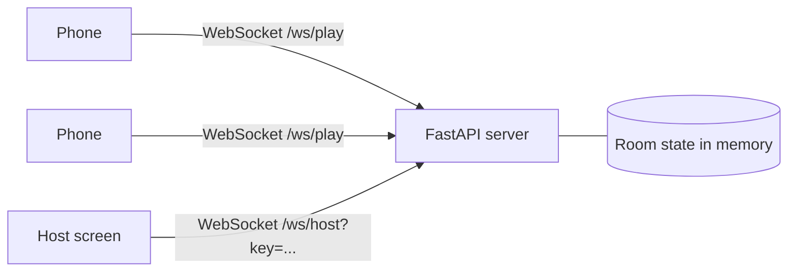

# Halloween Office Trivia

A realtime party game for coworkers. Everyone scans a QR code, joins on their own phone, and plays on a shared host screen.

**Status: framework stage.** The lobby, QR join, live connection check and security basics are in place. The game rounds are next (see the roadmap).

## What works today

- Phones join by scanning a QR code and entering a name. No accounts, no installs.
- The host screen shows who is connected, each phone's round-trip latency, and a **test buzz** that proves realtime delivery on your network.
- Phones reconnect on their own after a dropped connection or a screen lock, and keep their seat.
- The host can lock the game once everyone is in, and remove anyone.
- Nothing is loaded from outside the app (no CDNs, no web fonts), so it works on locked-down networks.

## Run it locally

```bash
python -m venv .venv && source .venv/bin/activate
pip install -r requirements.txt
uvicorn app.main:app --host 0.0.0.0 --port 8000
```

The terminal prints a private host link, like `http://localhost:8000/host?key=...`. Open it on the laptop that drives the big screen. The QR code uses the laptop's LAN address, so phones on the same Wi-Fi can scan it.

## Test it in the office

Check each of these before the party:

1. A phone on the venue Wi-Fi scans the QR code and joins.
2. A phone on cellular joins too. This needs a public address (see below), because cellular can't reach a laptop's LAN address.
3. Press **Send test buzz** on the host screen. Every phone should flash and show a reply time under about 200 ms.
4. Lock the phone screen for 30 seconds, then unlock it. It should show **Connected** again with the same name.

For a quick public address from your laptop, use a [Cloudflare quick tunnel](https://developers.cloudflare.com/cloudflare-one/connections/connect-networks/do-more-with-tunnels/trycloudflare/):

```bash
cloudflared tunnel --url http://localhost:8000
PUBLIC_URL=https://<the-address-it-prints> uvicorn app.main:app --host 0.0.0.0 --port 8000
```

## Deploy

Build the included `Dockerfile` on any host that supports WebSockets (Render, Fly.io, a small VM). Set these environment variables:

| Variable | Purpose |
| --- | --- |
| `HOST_KEY` | Secret that unlocks `/host`. Set it so a restart doesn't change your host link. |
| `PUBLIC_URL` | The deployed address, used for the QR code, e.g. `https://trivia.onrender.com`. |

Run **one instance only**: game state lives in memory. Free tiers go to sleep when idle, so open the site a few minutes before the party. Delete the service afterwards.

## How it works



The server is the single source of truth. Phones only send intentions (join, reply to a buzz), and the server decides what happens and tells everyone. `app/game.py` holds the rules with no web code, so they are easy to test.

## Security notes

- The host screen and host socket require `HOST_KEY` (compared in constant time).
- Names are cleaned (whitespace, control and invisible characters, length) and always rendered as text, never as HTML.
- Per-connection rate limit, message size cap, and a 30-player cap.
- Private player tokens are never sent to the host screen.
- Strict Content-Security-Policy, no framing, no referrer, and API docs turned off.

## Tests

```bash
pip install -r requirements-dev.txt
pytest
```

## Project layout

```
app/
  main.py        routes, WebSockets, security headers
  game.py        lobby rules and state (no web code)
  ratelimit.py   token-bucket limiter
  static/        host and phone pages
tests/           unit tests for the rules, plus end-to-end WebSocket tests
```

## Roadmap

- [ ] Round engine with timers, controlled from the host screen
- [ ] Section A: guess the office slang from emojis (fuzzy matching, host override)
- [ ] Section B: finish the nightmare meeting phrase, then everyone votes
- [ ] Scores per section, round and overall, with winners announced
- [ ] Join mid-game, with missed rounds marked absent
- [ ] Tiebreaker prompt
- [ ] Prompts loaded from a config file kept out of the public repo
